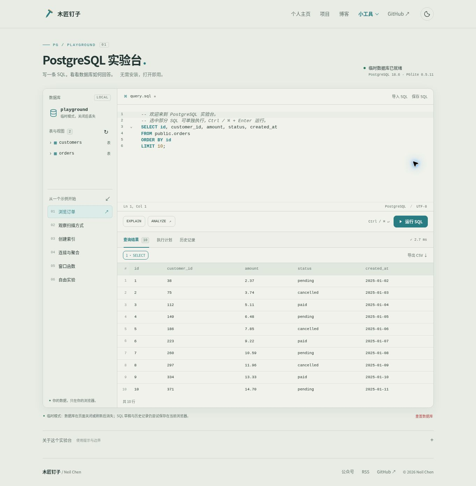

# PostgreSQL 实验台

在浏览器里运行 PostgreSQL，编写 SQL、探索表结构、比较执行计划。纯静态网页，无需数据库服务器。

目标地址：<https://cznail.github.io/pg-playground/>



## 功能

- CodeMirror 编辑器：SQL 高亮、补全、选区运行、Ctrl / ⌘ + Enter。
- 多条 SQL 与多个结果集，保留重复列名。
- EXPLAIN 计划树、节点详情及原始 JSON；ANALYZE 按钮在只读事务中执行，拒绝写入。
- 自动刷新表/视图结构，一键载入预览 SQL。
- IndexedDB 持久化，本地保存 SQL 草稿与最近 30 次历史；提供临时内存模式。
- SQL 文件导入、保存，CSV 导出，一键重置数据库。
- 预置 1,000 位客户与 20,000 条订单，覆盖扫描、索引、连接、聚合与窗口函数。
- 复用主页公共导航、页脚、字体、品牌颜色和浅色/深色主题。

## 本地开发

使用 Node.js 24：

```sh
npm ci
npm run dev
```

访问终端给出的 `/pg-playground/` 地址。验证与构建：

```sh
npm test
npm run build
```

构建产物在 `dist/`，可通过 `npm run preview` 预览。部署路径由 `vite.config.ts` 的 `base` 指定。WASM 与数据库初始化资源随网站部署，运行时无需 CDN。

## GitHub Pages

1. 仓库 Settings → Pages → Build and deployment，将 Source 设为 **GitHub Actions**。首次启用需要仓库管理权限。
2. 推送 `main`，或者运行 **Deploy PostgreSQL playground** 工作流。
3. 工作流先运行真实 PGlite 测试、公共样式校验、TypeScript 检查与生产构建，再部署 Pages。PR 仅检查，不部署。

`homepage.json` 提供主页项目卡片和“小工具”入口。主页下一次成功同步部署后收录；当前入口需 Pages 开启且不返回 404/410。

## 数据与运行边界

- 数据只保存在访问者浏览器，不会发送到服务器，不会跨设备自动同步。清理网站数据会删除数据库、草稿及历史；SQL 文件导出不是数据库备份。
- 数据库运行于独立 Worker。持久化模式通过 Web Locks 限制一个浏览器中仅一个实验台标签页打开数据库；另一页会提示关闭其他页面或使用临时模式。临时模式不覆盖持久化数据库。
- 数据目录 `idb://neil-pg-playground-v1` 对应 IndexedDB `/pglite/neil-pg-playground-v1`。重置只删除此数据库，不清理同源其他工具的数据，保留 SQL 草稿与历史记录。
- 初始化标记与示例生成位于同一事务，刷新不会重复插入示例，也不会因用户删除示例表而自动重建。重置后才恢复示例。
- 每条语句最多向页面返回、导出前 1,000 行，每页显示 100 行。查询仍可能在 Worker 中产生大量数据，请使用 LIMIT 限制大结果。
- 设置 `statement_timeout=20s`、`lock_timeout=5s`，主线程另有 60 秒兜底终止。WASM 环境中 SQL 超时不作为唯一保障。终止后需要重连，部分完成的语句可能已提交。
- EXPLAIN/ANALYZE 按钮使用单语句协议，拒绝多语句。ANALYZE 按钮使用只读事务，用户存在未结束事务时要求先 COMMIT / ROLLBACK。手工运行的 SQL 按原意执行，包括写入、显式事务及 EXPLAIN ANALYZE。
- 显示耗时含浏览器和持久化开销，不代表服务器 PostgreSQL 性能。扩展能力以 PGlite 为准，不模拟服务端并行、多进程或真实磁盘 I/O。

## 公共外观

上游为 `czNail/cznail.github.io/packages/site-ui`。`vendor/site-ui` 是不可手改的已校验快照，版本与 SHA-256 存于 `site-ui.lock.json`。普通构建无需访问上游。

```sh
node scripts/sync-site-ui.mjs --update
npm test
npm run build
```

定时 **Update shared site UI** 工作流检查上游并尝试创建升级 PR。GitHub 需允许 Actions 创建 PR；不允许时可本地执行上述命令后提交。页面布局在 `src/style.css`，共享品牌变量通过 `var(--site-*)` 使用。

## 验证

`tests/database.test.ts` 使用真实 PGlite，覆盖初始化幂等性、多语句、重复列名、结果上限、索引前后计划变化、只读分析、事务恢复及 CSV。浏览器检查覆盖生产子路径资源、查询/计划交互、SQL 草稿恢复、临时模式重置和主题。HTTP 本地预览不能验证 Web Locks；持久化、标签页锁与 IndexedDB 重置需在 HTTPS 部署后继续验证。
